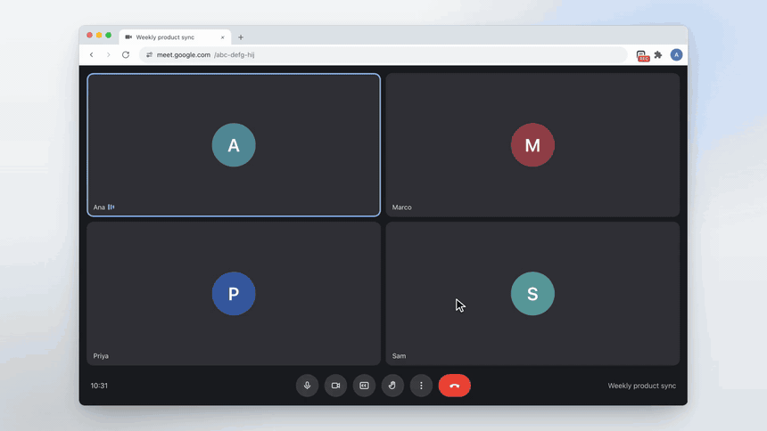
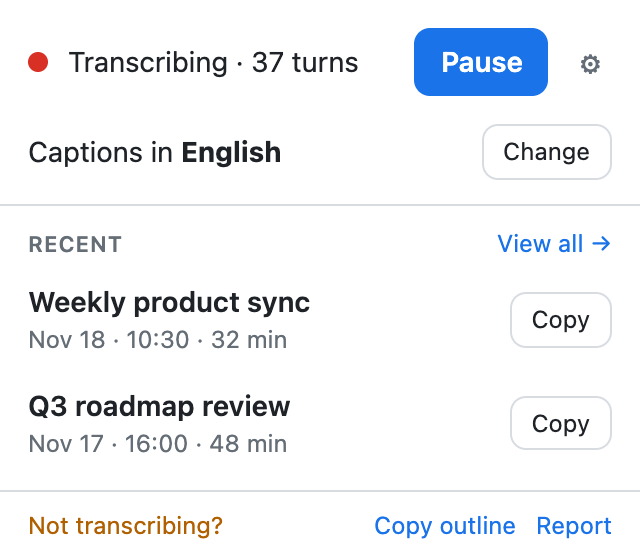
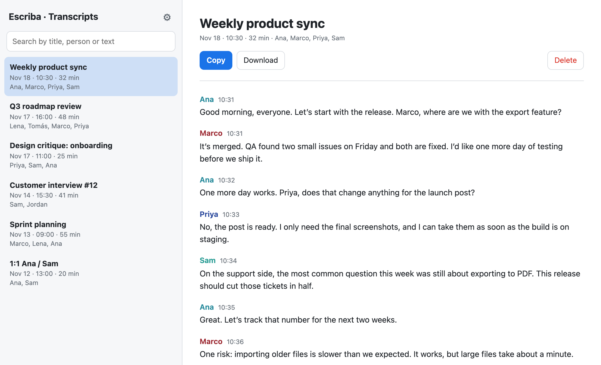

# Escriba

[](https://github.com/AbdielOtzoy/escriba/actions/workflows/ci.yml)

Extensión de navegador que transcribe tus reuniones de Google Meet a Markdown, con el
nombre de quien habla. No entra un bot a la reunión y nada sale de tu equipo: lee los
subtítulos que Meet ya genera.



[Video de 30 segundos](https://abdielotzoy.github.io/escriba/#video) · [Sitio web](https://abdielotzoy.github.io/escriba/) · [Política de privacidad](https://abdielotzoy.github.io/escriba/privacy) · [Cambios](CHANGELOG.md) · [Read in English](README.md)

## Instalar (Brave, Chrome o Edge)

1. Clona o descarga esta carpeta.
2. Abre `brave://extensions` (o `chrome://extensions`).
3. Activa **Modo de desarrollador**.
4. **Cargar extensión sin empaquetar** y elige esta carpeta.
5. En `brave://settings/downloads` desactiva **Preguntar dónde guardar cada archivo**;
   si queda activo, el navegador pregunta en cada reunión.

No hay nada que compilar: la extensión corre directamente desde los archivos fuente.

## Usar

Entra a una reunión. La extensión activa los subtítulos, los oculta de la pantalla (el
video recupera ese espacio; la transcripción sigue igual) y el icono de la extensión
muestra **REC** en rojo. Fija el icono en la barra para verlo. Al pasar el cursor por
encima se ve cuántas intervenciones lleva.

<p>
  
  
</p>

Un clic en el icono abre un menú con:

- el estado de la reunión y un botón para **Pausar** (**II** en gris) o **Reanudar**;
- el idioma de los subtítulos, con un botón **Cambiar** que abre ese ajuste en Meet;
- las dos últimas transcripciones, cada una con un botón **Copiar**;
- **Ver todas las transcripciones**, una página con buscador para leerlas, copiarlas,
  volver a descargarlas o borrarlas;
- los ajustes.

Al salir de la llamada o cerrar la pestaña, la transcripción se guarda en dos lugares:

- como archivo, en `Descargas/transcripciones-meet/2026-11-12 1030 - Título de la reunión.md`;
- en el navegador, que es lo que muestran el menú y la página de transcripciones. Esta
  copia vive solo en este navegador y se pierde si quitas la extensión (recargarla no la
  borra).

Si el navegador se cierra de golpe, la transcripción se guarda al volver a abrirlo.

Si deja de poder transcribir más de 20 segundos (subtítulos apagados, o Meet cambió), el
icono pasa a **!** en ámbar y sale una notificación del sistema. Para verla, el navegador
necesita permiso de notificaciones en los ajustes del sistema operativo.

### Ajustes

- **Transcribir automáticamente al entrar a una reunión** (activado por defecto). Apagado,
  la extensión no hace nada al entrar; pulsa **Transcribir** en el menú en las reuniones
  que quieras.
- **Avisarme si el idioma de los subtítulos no es el de mi navegador** (apagado por defecto).

## Pregúntale a tu IA por tus reuniones

Un servidor MCP opcional, que se instala aparte de la extensión, deja que Claude, Cursor o
cualquier otra app compatible con [MCP](https://modelcontextprotocol.io) liste, busque y lea
tus transcripciones. Así puedes preguntar, por ejemplo, «¿Qué acordamos hoy en la reunión de
producto?». Con Claude Code:

```
claude mcp add escriba -- npx -y escriba-mcp
```

El servidor corre en tu equipo, solo lee los archivos de las transcripciones y no hace
peticiones de red. La app de IA a la que lo conectes sí recibe lo que lee: un asistente en
la nube le envía ese texto a su proveedor. Cómo configurarlo en Claude Desktop y otras apps:
[mcp/README.md](mcp/README.md) (en inglés).

## A tener en cuenta

- Meet transcribe en un solo idioma: el elegido en sus ajustes de subtítulos, que recuerda
  entre reuniones. La extensión no puede saber en qué idioma se habla; muestra el activo,
  avisa la primera vez y puede compararlo con el del navegador.
- Solo se captura lo dicho desde que entras, y mientras los subtítulos estén activos.
- Tu propia voz aparece con la etiqueta que Meet te pone (normalmente «Tú»).
- No se guarda audio ni el chat de la reunión.
- Los subtítulos quedan ocultos mientras la extensión transcribe.

## Si deja de capturar

Google cambia el HTML de Meet cada cierto tiempo. Todo lo que depende de él está en
`src/content/meet-dom.js`, y `test/fixtures` guarda muestras de ese HTML: actualiza la
muestra con lo que Meet tiene ahora y `npm test` dice qué se rompió.

Para reportarlo, abre el menú del icono en la pestaña de Meet y pulsa **Copiar esquema de
la página** en «¿Dejó de funcionar?», y pégalo en un issue. El esquema lleva las etiquetas,
los roles y los nombres de iconos de la página, sin nombres, textos ni el código de la
reunión. No se envía nada: solo va a tu portapapeles.

## Desarrollo

```
npm install     # solo las herramientas de desarrollo; la extensión no tiene dependencias
npm run check   # linter, formato, tipos y pruebas
```

La estructura del código está descrita en el [README en inglés](README.md#development).

## Licencia

[MIT](LICENSE)
