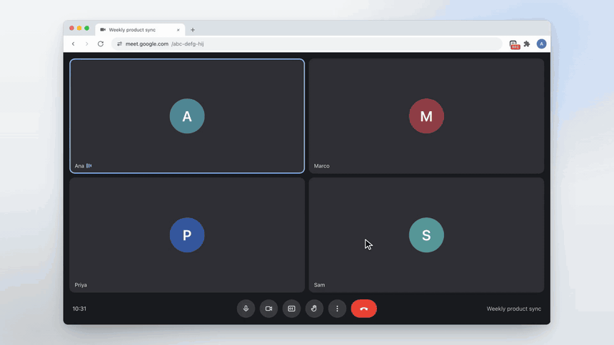
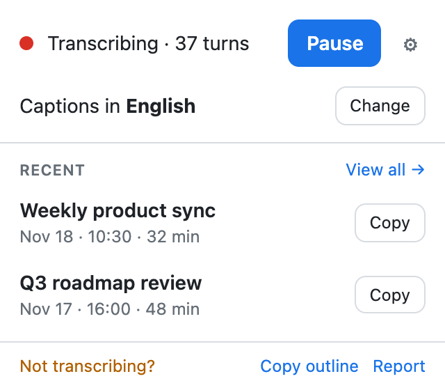
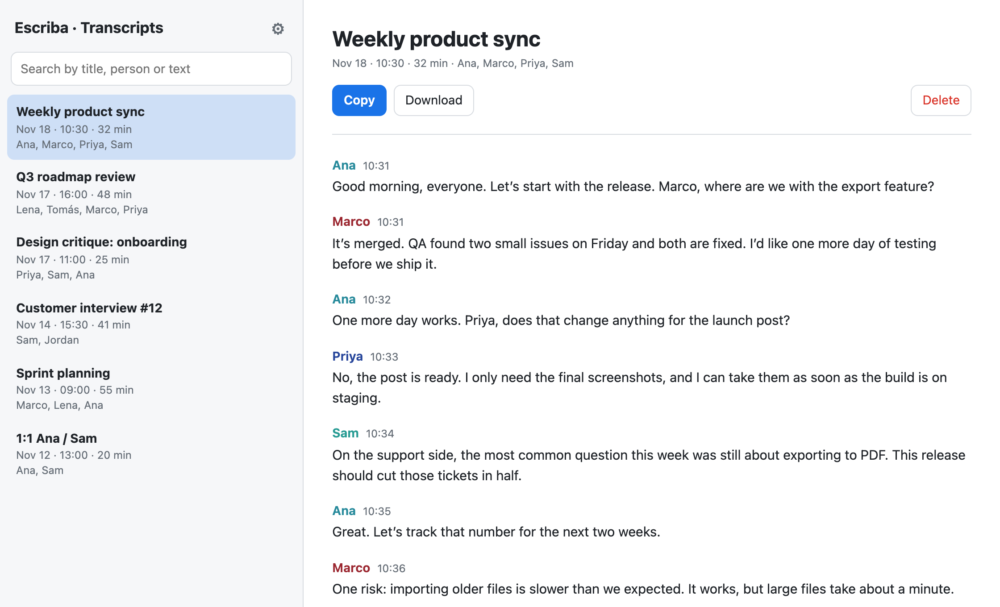

# Escriba

[](https://github.com/AbdielOtzoy/escriba/actions/workflows/ci.yml)

Browser extension that transcribes your Google Meet meetings to Markdown, with the name
of who is speaking. No bot joins the call and nothing leaves your computer: it reads the
captions Meet already generates.



[Video (33 s)](https://abdielotzoy.github.io/escriba/#video) · [Website](https://abdielotzoy.github.io/escriba/) · [Privacy policy](https://abdielotzoy.github.io/escriba/privacy) · [Changelog](CHANGELOG.md) · [Leer en español](README.es.md)

## Install (Brave, Chrome or Edge)

1. Clone or download this folder.
2. Open `brave://extensions` (or `chrome://extensions`).
3. Turn on **Developer mode**.
4. **Load unpacked** and pick this folder.
5. In `brave://settings/downloads` turn off **Ask where to save each file before
   downloading**; while it is on, the browser asks on every meeting.

Nothing needs to be built: the extension runs straight from the source files.

## Use

Join a meeting. The extension turns the captions on, hides them from the screen (the video
gets that space back; the transcript is unaffected) and the extension icon shows **REC**
in red. Pin the icon to the toolbar to see it. Hovering over it shows how many turns have
been captured.

<p>
  
  
</p>

Clicking the icon opens a menu with:

- the status of the meeting and a button to **Pause** (**II** in gray) or **Resume**;
- the caption language, with a **Change** button that opens that setting in Meet;
- the last two transcripts, each with a **Copy** button;
- **View all**, a page with search to read, copy, download again or delete them;
- **⚙**, which opens the settings on that page (also reachable from its own ⚙).

When you leave the call or close the tab, the transcript is saved in two places:

- as a file, in `Downloads/transcripciones-meet/2026-11-12 1030 - Meeting title.md`;
- in the browser, which is what the menu and the transcripts page show. This copy lives
  only in this browser and is lost if you remove the extension (reloading it keeps it).

If the browser closes abruptly, the transcript is saved when it is opened again.

If transcription stops being possible for more than 20 seconds (captions turned off, or
Meet changed), the icon turns to **!** in amber and a system notification appears. To see
it, the browser needs notification permission in the operating system settings.

### Settings

- **Transcribe automatically when I join a meeting** (on by default). When off, the
  extension does nothing on joining; press **Transcribe** in the menu for the meetings
  you want.
- **Warn me if the caption language is not my browser's language** (off by default).

## Ask your AI about your meetings

An optional MCP server, installed apart from the extension, lets Claude, Cursor or any other
app that supports [MCP](https://modelcontextprotocol.io) list, search and read your
transcripts. Then you can ask, for example, "What did we agree in today's product sync?".
With Claude Code:

```
claude mcp add escriba -- npx -y escriba-mcp
```

The server runs on your computer, only reads the transcript files and makes no network
requests. The AI app you connect it to does receive what it reads: a cloud assistant sends
that text to its provider. Setup for Claude Desktop and other apps:
[mcp/README.md](mcp/README.md).

## Good to know

- Meet transcribes in a single language: the one chosen in its caption settings, which it
  remembers between meetings. The extension cannot tell which language is being spoken; it
  shows the active one, warns the first time, and can compare it with the browser's.
- Only what is said after you join is captured, and only while captions are on.
- Your own voice appears with the label Meet gives you (usually "You").
- No audio is saved, and neither is the meeting chat.
- Captions stay hidden while the extension is transcribing.

## If it stops capturing

Google changes Meet's HTML from time to time. Everything that depends on it is in
`src/content/meet-dom.js`, and `test/fixtures` holds samples of that HTML: update the
sample with what Meet looks like now and `npm test` shows what broke.

To report it, open the icon menu in the Meet tab and press **Copy outline** next to
"Not transcribing?", then paste it into an issue. The outline has the tags, roles and icon
names of the page, and no names, text or meeting code. Nothing is sent: it only goes to
your clipboard.

## Development

```
npm install     # only the development tools; the extension has no dependencies
npm run check   # lint, format check, type check and tests
```

| Path                         | What it is                                                                                                                                    |
| ---------------------------- | --------------------------------------------------------------------------------------------------------------------------------------------- |
| `src/content/`               | Runs inside Meet: `meet-dom.js` reads Meet's HTML, `layout.js` hides the captions, `watchdog.js` detects failures, `main.js` coordinates them |
| `src/page/`                  | A small patch that runs in the page's own JavaScript world                                                                                    |
| `src/background/`            | Service worker: saves the files, keeps the history, paints the icon                                                                           |
| `src/popup/`, `src/history/` | The menu of the icon and the transcripts page                                                                                                 |
| `src/shared/`                | Constants, texts, transcript format and history, used by all of the above                                                                     |
| `_locales/`                  | Texts in English and Spanish                                                                                                                  |
| `test/`                      | Tests, with samples of Meet's HTML in `test/fixtures`                                                                                         |
| `mcp/`                       | The optional MCP server, a separate npm package (`escriba-mcp`)                                                                               |

Source files are classic scripts, each declaring one global, loaded in the order listed in
`manifest.json` and in the HTML pages. Types are checked from JSDoc comments.

## License

[MIT](LICENSE)
