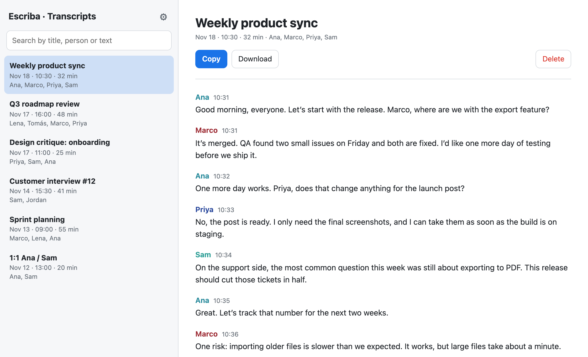
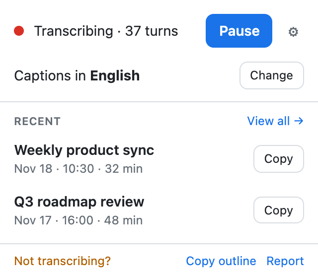

I wanted a written record of my calls: who said what, as a text file I can search and
keep. The usual answers did not fit. A bot that joins the meeting is visible to everyone
and sends the conversation to a server. Recording the audio needs permission to record and
a speech model, and still does not know who is speaking.

Google Meet already does the hard part. With captions on, it runs speech recognition and
shows each line next to the speaker's real name. The text is in the page; it only has to be
read.

That became [Escriba](https://github.com/AbdielOtzoy/escriba), a Manifest V3 extension for
Chromium browsers. It turns captions on when you join, hides them, reads them as they
change, and when you leave it writes a Markdown file to your Downloads folder:

```text
---
title: "Daily"
date: 2026-11-12
start: "10:00"
duration_min: 15
participants: ["Ana Pérez","Luis Gómez"]
language: "Español (México)"
link: https://meet.google.com/abc-defg-hij
---

# Daily

**Ana Pérez** (10:00)

Buenos días a todos. Empezamos con el reporte.

**Luis Gómez** (10:01)

Perfecto, yo sigo después.
```

(The names and sentences are invented, from the test fixtures.)

One rule shaped everything after that: **no network at all.** No server, no analytics, no
remote code. The permissions are `downloads`, `storage`, `unlimitedStorage`,
`notifications` and access to `meet.google.com`. The transcript only leaves the computer if
you copy it somewhere.

Those files are also the input for the other half of the project: a local
[MCP](https://modelcontextprotocol.io) server that lets Claude, Cursor or any MCP client
list, search and read your meetings, so you can ask _"what did we agree in Tuesday's sync?"_
without a meeting bot or a transcription service in between. The extension's job is to make that
data complete and trustworthy, which is what most of this article is about.



Reading text from a page sounds like an afternoon. Making it hold up in a real call is
where the work was. What I learned is written down in the repository as a list of things
not to "simplify" without testing in a call; here they are.

## Turning captions on is two clicks

The captions button in Meet's toolbar does not turn captions on. It opens a menu, and the
real "Turn on captions" button is inside that menu. Two details made this harder than it
looks: pressing the toolbar button again while the menu is open closes it, and closing the
menu before the captions appear cancels the activation.

So the code clicks the real button if it is already visible (older Meet had it in the
toolbar), otherwise opens the menu once, and clicks inside it a moment later:

```js
function turnCaptionsOn() {
  const turnOn = () => findButton(ICON.CAPTIONS_OFF, LABEL.TURN_ON_CAPTIONS);
  const direct = turnOn();
  if (direct) return direct.click();
  const menu = [...document.querySelectorAll('button')].find(
    (b) =>
      (b.textContent || '').trim() === ICON.CAPTIONS_MENU && attr(b, 'aria-expanded') !== 'true',
  );
  if (!menu) return;
  menu.click();
  openedMenu = menu;
  setTimeout(() => turnOn()?.click(), 600);
}
```

The `aria-expanded` check is what keeps a second call from closing the menu it just
opened. Only once the caption region exists does the script send Escape to close the menu;
at that point it no longer cancels anything.

## Finding elements when class names change

Meet's class names are generated and change between releases, so they are useless as
selectors. What does not change is the icons. Meet renders them as text ligatures in an
icon font: the hang-up button contains `<i>call_end</i>`, whatever language the interface
is in. That is the first thing the code looks for. ARIA labels are a fallback, matched
against English and Spanish, and classes are never used:

```js
const ICON = Object.freeze({
  LEAVE_CALL: 'call_end',
  CAPTIONS_OFF: 'closed_caption_off',
  CAPTIONS_MENU: 'translate_cc',
  LANGUAGE: 'language',
  SETTINGS: 'settings',
});

function findButton(icon, label) {
  return [...document.querySelectorAll('button')].find(
    (b) => iconLeaf(b, icon) || (label && label.test(attr(b, 'aria-label'))),
  );
}
```

"Am I in a call?" is just "is there a hang-up button?".

All of this lives in one file, `src/content/meet-dom.js`, the only file allowed to know
Meet's HTML. Next to it, `test/fixtures/` holds samples of the call page, written from
dumps of the live page with the class names removed and the names and sentences invented.
Those samples are the contract: when Google changes Meet and capture stops, the fix is to
take a new dump, update the sample, and let the tests show what broke. One test strips
every `aria-label` and checks that everything is still found, as it would be with Meet in
a language the code has no labels for.

## Text that rewrites itself

The obvious approach, appending new caption text as it appears, produces a transcript full
of stutters, because Meet does not append. While someone talks, it rewrites the whole
block, correcting earlier words as it hears more. When the block gets long, it empties it
and starts over.

So each caption block on screen feeds one entry, tracked in a `WeakMap` keyed by the block
element, and every update replaces the entry's text instead of adding to it. A sudden drop
in length means Meet started over, which opens a new entry instead of losing the old one:

```js
function updateEntry(entries, entry, name, text, now) {
  if (!text) return entry;
  if (!entry || entry.name !== name || text.length < entry.text.length - 100) {
    entry = { name, time: now, text };
    entries.push(entry);
  } else {
    entry.text = text;
  }
  return entry;
}
```

## Hiding the captions without leaving a hole

Nobody wants captions covering the video for the whole call, so Escriba hides them. They
have to stay in the DOM, because that is what is being read, so the strip gets
`opacity: 0` and `pointer-events: none`. That leaves an empty band at the bottom where the
captions were, with the video still shrunk above it.

The reason is not obvious: Meet sizes the video from
`document.documentElement.clientHeight`, not from the space it measures on screen. A
content script cannot change what Meet's own code sees, because it runs in an isolated
JavaScript world. So there is a second, tiny script declared with `"world": "MAIN"` and
`"run_at": "document_start"`, which runs in the page's world before Meet and reports a
taller window:

```js
const extra = () => Number(document.documentElement.dataset.escribaExtra) || 0;

const clientHeight = Object.getOwnPropertyDescriptor(Element.prototype, 'clientHeight')?.get;
if (clientHeight) {
  Object.defineProperty(document.documentElement, 'clientHeight', {
    configurable: true,
    get() {
      return clientHeight.call(this) + extra();
    },
  });
}
```

`window.innerHeight` gets the same treatment. The two worlds share the DOM but not
JavaScript objects, so they talk through an attribute: the content script measures the
caption strip and writes its height to `<html data-escriba-extra>`, and the page script
adds it. Without the attribute, the patch changes nothing.

The video size turned out to be one of three things sitting on the caption strip. The
bottom edge of `<main>` is still cut short by CSS, and emoji reactions float up from that
edge, so they started in mid-air; a stylesheet gives it a negative bottom margin. And Meet
stacks some notices, like a chat message preview, right above the strip; those get moved
down by the same height. After each change the script fires a `resize` event so Meet
recomputes the layout.

Meet also rewrites the inline styles of those elements whenever it likes, so hiding is not
done once. It runs on every tick, and returns early when the height has not changed.

## Background tabs and timers

The content script has a 2-second tick, and capturing on it looks like the natural choice.
It breaks as soon as you switch tabs during a call. Browsers throttle timers in background
tabs, eventually to as little as once a minute, and a minute is a lot of rewritten
captions.

Capture now runs from a `MutationObserver` on the caption region, which fires when the DOM
changes, whether the tab is visible or not:

```js
observer.observe(found, { childList: true, subtree: true, characterData: true });
```

The tick only does housekeeping: noticing that you joined or left (two readings in a row
outside the call, so a repaint does not end the meeting), turning captions back on if they
went off, hiding them again, and writing a backup.

## Failing loudly, and surviving reloads

A transcription tool that silently stops is worse than none, because you find out after the
meeting. A few pieces exist only for that.

**Orphaned content scripts.** When an extension is reloaded or updated, the old content
script keeps running in the open Meet tab, but every `chrome.*` call from it throws. Every
such call in the content script goes through one wrapper that shuts the script down instead
of failing on each tick:

```js
function extension(call) {
  try {
    return call().catch(() => undefined);
  } catch {
    shutDown();
    return Promise.resolve(undefined);
  }
}

const send = (message) => extension(() => chrome.runtime.sendMessage(message));
```

I learned how strict that rule has to be from a bug: one call to
`chrome.i18n.getUILanguage()` outside the wrapper threw in old scripts after a reload. It
is now read once, at load, while the context is still valid.

**Crash recovery.** On each tick with new text, the meeting so far is saved to
`chrome.storage.local` under a `pending_<start>` key. The service worker saves those
backups as transcripts when the same tab loads a new page, when the tab is closed, and when
the browser starts again.

**The watchdog.** If captions are off and cannot be turned on, or there are speakers on
screen but no text can be read (which means Meet's HTML changed), and that lasts more than
20 seconds, the toolbar icon turns amber and a system notification appears.



**Bug reports without private data.** When Meet changes, I need to see its new HTML, but a
user's page is full of names and conversation. The icon menu has a "Copy outline" button
that copies an outline of the page: tags, roles, ARIA states, inline positions and icon
names. No text, no label values, no links, no images; runs of identical siblings collapse
to `(same ×N)`. It goes to the clipboard, not anywhere else, and an end-to-end test checks
that no name or sentence from the call ends up in it.

## Trusted Types

Meet enforces Trusted Types, so assigning a string to `innerHTML` throws inside the page.
That settled a rule I would want anyway: DOM is built with `createElement` and
`textContent`, everywhere. In the extension's own pages the transcript text and the meeting
title are untrusted input too, so the same rule protects them:

```js
const title = document.createElement('strong');
title.textContent = item.title;
```

## Testing something you cannot automate against

I cannot run the tests against real Meet: there is no account in CI, nobody to talk, and
Google can change the page at any time. So there are four layers, each covering what the
one before it cannot.

1. **Pure logic** (`transcript.js` has no DOM and no `chrome.*`), tested with `node --test`.
2. **The Meet adapter against the fixtures**, using jsdom.
3. **The whole content script in a simulated browser.** One test loads every content file
   in manifest order over the fixture, with a fake `chrome` object and Node's mock timers,
   and walks a call from joining to leaving: ticks, capture, a rewrite, a pause, the
   backup and the final save.
4. **The real extension in Chromium** with Playwright, launched with `--load-extension`,
   with `https://meet.google.com/**` routed to a fake Meet page built from the same
   fixtures. It catches what the others cannot: the manifest's load order, the service
   worker, the download, and the two JavaScript worlds agreeing:

```js
await expect(page.locator('html')).toHaveAttribute('data-escriba-extra', '216');
expect(await page.evaluate(() => document.documentElement.clientHeight)).toBe(height + 216);
```

None of that is real Meet. After any change to the content scripts, someone still has to
reload the extension and join a call: the icon shows REC within a few seconds, no captions
are visible and the video uses the full height, an emoji reaction floats up from just above
the toolbar, the turn count grows while someone talks, and leaving produces a `.md` file.
The guide for coding agents in the repository tells them to ask for this check rather
than report a change as verified.

## No build step

The extension has no bundler, no TypeScript sources and no runtime dependencies. The
browser loads the files in `src/` as they are. Every file is a classic script that declares
exactly one top-level name, like `transcript` or `meetDom`, and files see each other
through those globals in load order. The cost is bookkeeping: adding a file means updating
the manifest, the HTML pages, the service worker's `importScripts`, the ESLint globals and
the tests. In exchange, what I debug is what I wrote, and anything can load a file the way
the browser does; the tests do it with `vm.runInThisContext`.

Types still get checked. Every exported function has JSDoc, and `tsc --noEmit` runs with
`checkJs` and `strict` over `src/`, alongside ESLint, Prettier and the tests in one
`npm run check`.

## Asking an AI about my meetings

A folder of Markdown files with front matter is a good input for a model. A separate
package, [`escriba-mcp`](https://www.npmjs.com/package/escriba-mcp), is a local MCP server
that Claude Code, Claude Desktop, Cursor or VS Code start as a child process over stdio. It
exposes three read-only tools, `list_meetings`, `search_transcripts` and `read_meeting`,
filtered by date and participant. It makes no network requests and never writes.

The tools are designed for the model that calls them: descriptions written as instructions,
a search capped at 50 hits that says when it was capped so the model narrows the query
instead of filling its context, accent-insensitive matching (`ibanez` finds `Ibáñez`), and a
setting that replaces Meet's "You" with your name so _"what did I commit to?"_ works. The
file name `read_meeting` receives is chosen by a model, so it is treated as untrusted input:
anything with a directory part is refused.

It does not have its own parser. Because the extension's files are plain classic scripts,
the server loads the same `transcript.js` the browser runs:

```js
const transcript = vm.runInThisContext(fs.readFileSync(parserFile, 'utf8') + '\ntranscript', {
  filename: parserFile,
});
```

Its dependencies (the MCP SDK and Zod) stay in that package, out of the extension. Setup
is one command:

```
claude mcp add escriba --env ESCRIBA_SELF_NAME="Your Name" -- npx -y escriba-mcp
```

Why tools instead of RAG, why stdio instead of HTTP, how it finds the Downloads folder on
each system and how the published package is tested are in
[a separate article about the MCP server](giving-an-ai-read-access-to-my-meetings).

## Limits

Reading captions instead of audio has costs, and I would rather list them than have someone
find them in a meeting that mattered:

- Only what is said after you join is captured, and only while captions are on. The first
  seconds of a call, before captions come up, are not in the transcript.
- Meet transcribes in one language, the one chosen in its caption settings, with no
  automatic detection. Text captured in the wrong language is still made of valid words,
  so the mismatch cannot be detected from it. Escriba shows the active language and can
  warn when it differs from your browser's.
- Your own voice is labeled the way Meet labels it, usually "You". The MCP server can
  replace that with your name; the files are not changed.
- The chat is not captured, and while Escriba is transcribing you do not see the captions
  yourself.
- Everything depends on Meet's HTML. When Google changes it, capture can break until the
  adapter and its fixtures are updated. The watchdog makes that visible; it does not
  prevent it.

Escriba is now on the
[Chrome Web Store](https://chromewebstore.google.com/detail/escriba-for-google-meet/pefbdollankflnpigefmonogfhnehjfc),
and the MCP server on npm. What comes next is mostly maintenance: keeping up with Meet.

The code is MIT-licensed at
[github.com/AbdielOtzoy/escriba](https://github.com/AbdielOtzoy/escriba), and the
[privacy policy](https://abdielotzoy.github.io/escriba/privacy) explains, in more detail,
that it collects nothing. Issues and outlines from broken calls are welcome.
